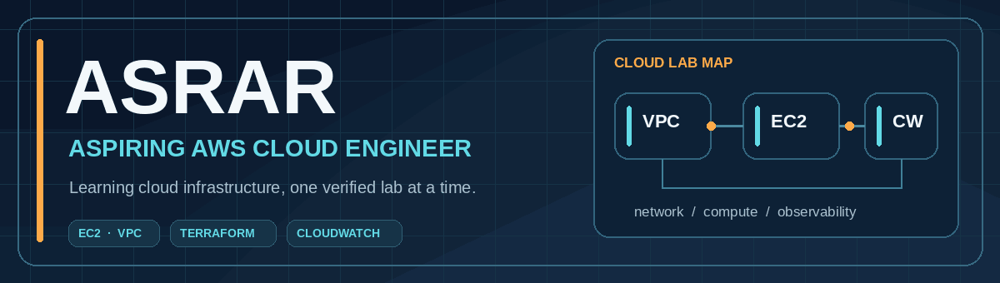
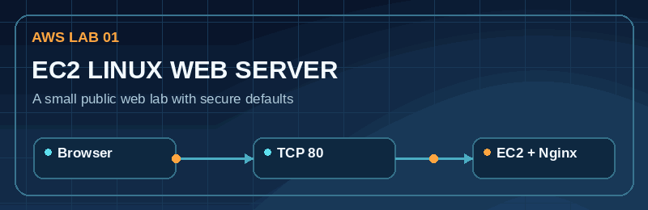
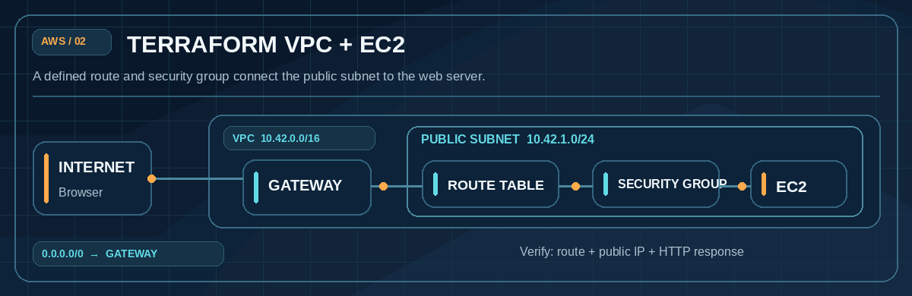
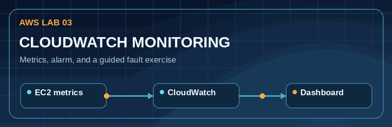
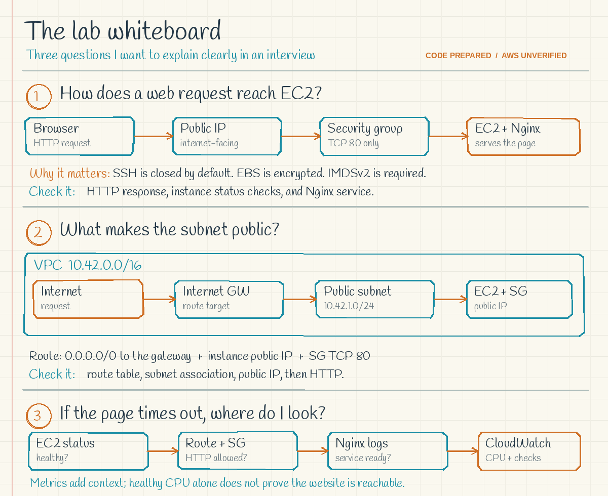

  <picture>
    <source media="(max-width: 600px)" srcset="assets/banner-mobile.gif">
    
  </picture>

### Hi, I'm Asrar 👋

I'm working toward an entry-level **AWS cloud support** or **junior cloud engineer** role. I use small, reproducible labs to learn how Linux servers, networking, infrastructure as code, and monitoring fit together. I document what I build, how to verify it, and how to clean it up.

> **Portfolio status:** The AWS configurations below are prepared as learning projects. They are not presented as deployed or tested in AWS. My [Azure portfolio](https://github.com/asrar-cloud/azure-cloud-engineer-portfolio) is a separate collection of Azure learning labs.

### Tools and topics I'm learning

   

## Featured AWS learning projects

<a href="https://github.com/asrar-cloud/aws-cloud-portfolio/tree/main/01-ec2-linux-web-server"><picture><source media="(max-width: 600px)" srcset="assets/project-1-mobile.gif"></picture></a>

**[Explore the EC2 Linux web server →](https://github.com/asrar-cloud/aws-cloud-portfolio/tree/main/01-ec2-linux-web-server)**  
Terraform, Amazon Linux 2023, Nginx, an HTTP security group, encrypted root storage, and IMDSv2. **Status:** Code prepared; AWS deployment unverified.

<a href="https://github.com/asrar-cloud/aws-cloud-portfolio/tree/main/02-terraform-vpc-ec2"><picture><source media="(max-width: 600px)" srcset="assets/project-2-mobile.gif"></picture></a>

**[Explore the Terraform VPC and EC2 lab →](https://github.com/asrar-cloud/aws-cloud-portfolio/tree/main/02-terraform-vpc-ec2)**  
A public subnet, internet gateway, route table, security group, and EC2 web server. **Status:** Code prepared; AWS deployment unverified.

<a href="https://github.com/asrar-cloud/aws-cloud-portfolio/tree/main/03-cloudwatch-troubleshooting"><picture><source media="(max-width: 600px)" srcset="assets/project-3-mobile.gif"></picture></a>

**[Explore CloudWatch troubleshooting →](https://github.com/asrar-cloud/aws-cloud-portfolio/tree/main/03-cloudwatch-troubleshooting)**  
An EC2 metrics dashboard, CPU alarm, and guided HTTP fault exercise. **Status:** Code prepared; AWS deployment unverified.

## The lab whiteboard

<picture>
  <source media="(max-width: 600px)" srcset="assets/whiteboard-mobile.png">
  
</picture>

These are my study prompts for explaining the architecture and troubleshooting steps. They describe what the code is intended to build; they are not AWS deployment evidence.

## Also exploring Azure

My [Azure cloud engineer portfolio](https://github.com/asrar-cloud/azure-cloud-engineer-portfolio) covers separate Azure labs in Linux, networking, Terraform, monitoring, and troubleshooting. I keep the AWS and Azure work clearly labeled so each project can be reviewed on its own.

## Learning roadmap

1. Deploy each AWS lab in a sandbox account, record my own verification, and destroy the resources.
2. Practise explaining VPC routing, security groups, EC2 bootstrapping, and CloudWatch alarms without notes.
3. Improve the labs with HTTPS, IAM access patterns, and repeatable checks after I understand the fundamentals.

## Contact

[GitHub profile](https://github.com/asrar-cloud) · [AWS portfolio](https://github.com/asrar-cloud/aws-cloud-portfolio)
